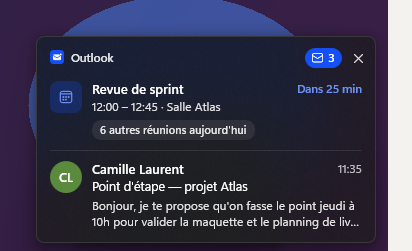
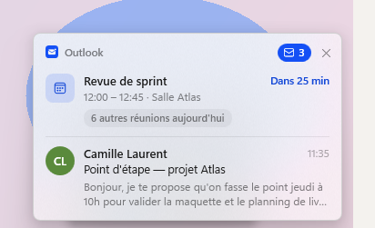
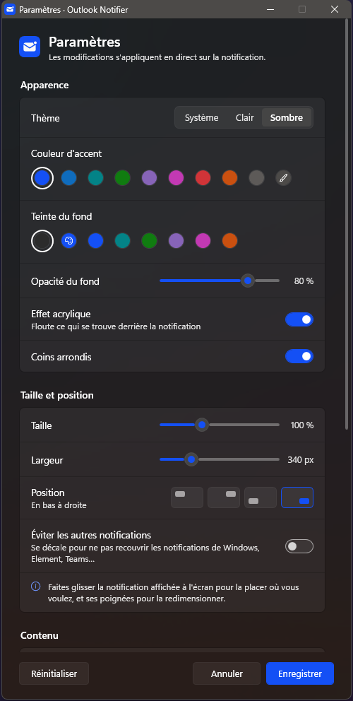

<p align="center">
  
</p>

<h1 align="center">Outlook Notifier</h1>

<p align="center">
  Une notification épurée pour Outlook sous Windows : la prochaine réunion du jour et le dernier e-mail non lu,<br>
  dans une carte acrylique qui reste à l'écran jusqu'à ce que vous vous en occupiez.
</p>

<p align="center">
  
  &nbsp;
  
</p>

---

## Fonctionnalités

- **Dernier e-mail non lu** : expéditeur, objet et début du message, avec le nombre total de non-lus dans le coin. Un clic ouvre la boîte de réception.
- **Réunions du jour** : la réunion en cours ou la prochaine, avec un compte à rebours (« Dans 25 min », « En cours ») et un badge « N autres réunions aujourd'hui ». Un clic ouvre le calendrier.
- **Persistante** : la carte reste affichée jusqu'au clic ou à la croix, et disparaît d'elle-même quand tous les messages ont été lus.
- **Rappel** : si vous la fermez alors qu'il reste des non-lus, elle revient toutes les 5, 10, 15, 30 ou 60 minutes (désactivable).
- **Ne recouvre pas les autres notifications** : elle se décale au-dessus (ou à côté) des notifications Windows et des fenêtres de notification d'autres applications (Element, Teams…), puis revient à sa place.
- **Ouvre Outlook automatiquement** (réduit) au démarrage s'il n'est pas lancé, puis à l'intervalle du rappel si vous l'avez fermé (désactivable).
- **Personnalisable avec aperçu en direct** : thème clair, sombre ou système, couleur d'accent, teinte et opacité du fond, effet acrylique, coins arrondis, taille, largeur et position. On fait glisser la carte n'importe où à l'écran (elle s'aimante aux coins) et on la redimensionne avec ses poignées.
- **Discrète** : ne vole jamais le focus, n'apparaît pas dans la barre des tâches, vit dans la zone de notification.

<p align="center">
  
</p>

## Compatibilité

| | |
|---|---|
| Windows | 10 (1803 et plus) et 11 |
| Outlook | Outlook classique 2016, 2019, 2021 et Microsoft 365 |
| Dépendances | aucune : .NET Framework 4.x est déjà intégré à Windows 10 et 11 |
| Réseau | aucun accès Internet nécessaire ni utilisé |

> Le « nouvel Outlook » (application `olk.exe`) n'expose pas d'interface d'automatisation et n'est donc pas pris en charge.

## Installation

1. Téléchargez `OutlookNotifier.msi` depuis la page [Releases](../../releases).
2. Lancez-le. L'application s'installe dans `C:\Program Files\Outlook Notifier`, démarre immédiatement et se lancera à chaque ouverture de session.

Installation silencieuse (déploiement) :

```bat
msiexec /i OutlookNotifier.msi /qn
```

Une nouvelle version remplace automatiquement la précédente. La désinstallation se fait depuis *Paramètres Windows > Applications*.

## Utilisation

- **Icône dans la zone de notification** : clic gauche pour les paramètres, clic droit pour le menu (afficher la notification, ouvrir la boîte de réception ou le calendrier, paramètres, quitter).
- **Notification** : clic sur la réunion pour ouvrir le calendrier, clic sur le message pour ouvrir la boîte de réception, croix pour fermer.
- **Paramètres** : les changements s'appliquent en direct. *Enregistrer* les conserve, *Annuler* (ou la fermeture de la fenêtre) les abandonne.

Options en ligne de commande :

| Option | Effet |
|---|---|
| `--demo` | affiche une notification d'exemple |
| `--settings` | ouvre directement les paramètres |
| `--quit` | ferme l'instance en cours (utilisé par l'installeur) |

## Confidentialité

- Tout reste sur le poste : l'application ne fait aucune requête réseau et n'envoie aucune donnée.
- Elle lit uniquement, en local via Outlook, la boîte de réception (nombre de non-lus, dernier message non lu) et le calendrier du jour.
- Réglages : `%APPDATA%\OutlookNotifier\settings.ini` (par utilisateur).
- Journal d'erreurs : `%LOCALAPPDATA%\OutlookNotifier\notifier.log` (erreurs techniques uniquement, aucun contenu de message).

## Fonctionnement

- Communication avec Outlook par COM en liaison tardive, sans assembly d'interopérabilité Office : la même application fonctionne avec toutes les versions d'Outlook classique.
- Toutes les interrogations d'Outlook passent par un thread dédié, toutes les 3 secondes. Les réunions sont relues toutes les 30 secondes, ou dès qu'un nouveau message arrive.
- La carte est une fenêtre WPF sans bordure qui ne prend pas le focus, avec un fond acrylique (Windows 10 et 11) et des coins arrondis natifs (Windows 11).
- Les notifications des autres sources sont repérées parmi les fenêtres visibles : surfaces de notification du shell Windows, et petites fenêtres « toujours au premier plan » des autres applications.

## Compiler depuis les sources

Aucun outil à installer : le script n'utilise que ce que Windows fournit (compilateur C# du .NET Framework, `msi.dll`, `makecab`). Ni Visual Studio ni WiX ne sont nécessaires.

```powershell
powershell -ExecutionPolicy Bypass -File build.ps1
```

Le script produit `dist\OutlookNotifier.msi` et `dist\OutlookNotifier.exe`.

### Structure

```
src/
  Program.cs              point d'entrée, icône de notification, rappel, lancement d'Outlook
  OutlookWatcher.cs       lecture d'Outlook par COM (non-lus, réunions du jour)
  NotificationWindow.cs   la carte : affichage, animations, déplacement et redimensionnement
  SettingsWindow.cs       le panneau de paramètres
  OtherNotifications.cs   détection des autres notifications à l'écran
  Settings.cs, Theme.cs   réglages et couleurs
  ui/Popup.xaml, ui/Settings.xaml   interfaces, chargées à l'exécution
installer/MsiBuilder.cs   génération du paquet MSI via msi.dll
build/make-icon.ps1       génération de l'icône
build.ps1                 compilation complète
```

## Limites connues

- Seuls les messages qui arrivent dans la **boîte de réception** déclenchent une notification. Ceux qu'une règle range directement dans un autre dossier n'en déclenchent pas.
- Sur un poste sans antivirus reconnu par Windows, Outlook peut afficher un avertissement de sécurité quand l'application lit l'expéditeur et le texte d'un message.
- Si les notifications Windows sont désactivées par une stratégie de groupe, aucun toast n'apparaît, et l'évitement ne concerne alors que les fenêtres des autres applications.

## Licence

Distribué sous licence MIT. Voir [LICENSE](LICENSE).

*Projet indépendant, sans lien avec Microsoft. Outlook est une marque de Microsoft Corporation.*
